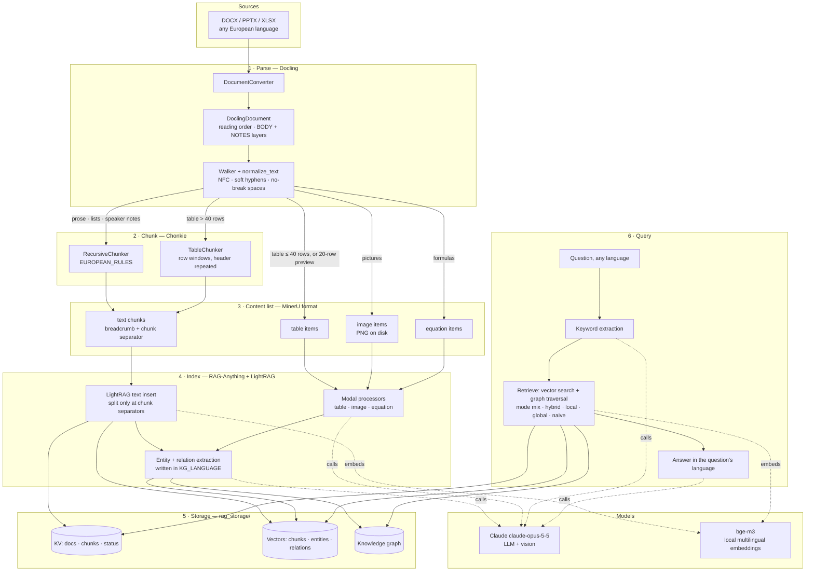

# Office-document RAG

Retrieval-augmented Q&A over **DOCX, PPTX and XLSX** files, built from:

| Stage | Library | Role |
|---|---|---|
| Parse | [Docling](https://docling.ai/) | Converts Office files into a structured document: headings, paragraphs, lists, tables, images, speaker notes, sheets |
| Chunk | [Chonkie](https://github.com/feyninc/chonkie) | `RecursiveChunker` for prose, `TableChunker` for large tables (header repeated in every chunk) |
| Index + query | [RAG-Anything](https://github.com/HKUDS/RAG-Anything) (on LightRAG) | Multimodal knowledge graph + vector index; tables and images are analysed by the LLM / vision model |
| Models | Claude (`claude-opus-5-5`) + local `sentence-transformers` embeddings | LLM, vision and embeddings |

## Architecture

A rendered copy is at [docs/architecture.png](https://github.com/Pakshalbhandari/brag/blob/main/docs/architecture.png), for editors that don't render Mermaid.



Each Chonkie chunk ends with a `␞` separator, and LightRAG is told to split only on it, so LightRAG keeps Chonkie's chunk boundaries instead of re-chunking. Documents get IDs from a hash of their contents, so re-ingesting an unchanged file is a no-op. A manifest (`rag_storage/brag_manifest.json`) records which file holds which document, so an edited file replaces its old version instead of sitting next to it.

## Installation

```bash
pip install brag-rag        # or: uv tool install brag-rag
```

This installs the `brag` command and the `brag` Python package. Then put your API key in the environment, or in a `.env` file in the directory you run `brag` from (see [.env.example](https://github.com/Pakshalbhandari/brag/blob/main/.env.example)):

```bash
export ANTHROPIC_API_KEY=sk-ant-...
```

The embedding model (`BAAI/bge-m3` by default, about 2.3 GB) downloads on first use. Switching it later means deleting `rag_storage/` and re-ingesting, because vector dimensions change.

### From source

```bash
uv sync
cp .env.example .env   # then set ANTHROPIC_API_KEY
uv run brag --help
```

## Usage

```bash
brag parse samples/sales.xlsx          # preview chunks; no API calls
brag ontology propose samples/         # optional: entity types for this corpus
brag ingest samples/ ~/Docs/q3.pptx    # files and/or folders (recursive)
brag query "Which region grew fastest?"
brag query "Summarise the Widget Pro launch" --mode hybrid
brag chat
```

Query modes: `mix` (graph + vector, default), `hybrid`, `local`, `global`, `naive` (vector only). Answers end with a References section listing the files and the slides, sheets or pages each fact came from.

### Keeping the index in sync

```bash
brag ingest samples/            # re-run any time: new files are added, edited ones replaced
brag list                       # what is indexed, and which files no longer exist
brag remove samples/old.pptx    # drop a file, or every file under a folder
```

`brag ingest` prints one line per file (`indexed`, `updated`, `unchanged`, `empty` or `failed`), the token usage, and exits with status 1 if any file failed, so it can run in scripts and CI. Files are named in the index by their path relative to where you run `brag`, so run it from the same folder each time.

Indexes built with brag 0.1 have no manifest. Their unchanged files are picked up on the next ingest; for files edited since, start over (`rm -rf rag_storage output`, then ingest).

### Entity types (ontology)

LightRAG tags entities with generic types (person, organization, location, event, concept, …). For a specific corpus, types such as `Product`, `SalesRegion` or `FinancialMetric` give a more useful graph:

```bash
brag ontology propose samples/   # samples the files, asks Claude, writes ontology.yaml
```

Review and edit `ontology.yaml`. Only the type `name`s are used for extraction; descriptions and examples are there to help you decide. Re-running `propose` on new documents only adds types, so your edits stay. To keep a type you deleted from coming back, list it under `rejected`. When `ontology.yaml` exists, `brag ingest` uses it. Changing types after ingesting only affects documents indexed afterwards, so re-index for a consistent graph; brag warns when the types differ from the ones the index was built with.

The approach (an LLM proposes a schema from samples of the data, a person reviews it, re-runs keep edits) follows [NVIDIA auto-ontology](https://github.com/NVIDIA/auto-ontology), which does this for relational databases.

The index is stored in `./rag_storage` and parsed images in `./output`, relative to the current directory (set `WORKING_DIR` / `OUTPUT_DIR` to change this).

From Python:

```python
from dotenv import load_dotenv
from brag import RAGPipeline

load_dotenv()  # optional: the library reads settings from the environment only

pipeline = RAGPipeline()
for result in await pipeline.ingest(["docs/"]):
    print(result.source, result.status, result.error)
answer = await pipeline.query("What is the Q4 outlook?")
await pipeline.remove(["docs/old.pptx"])
await pipeline.close()
```

## Multilingual documents

Documents in any European language (Latin, Greek and Cyrillic scripts, plus Armenian and Georgian) can be mixed in one index. No language detection or per-language setup is needed.

- **Normalisation** (`multilingual.normalize_text`): applies Unicode NFC, so decomposed accents such as `u` + `¨` become `ü`. It strips soft hyphens and zero-width characters, and turns no-break spaces (including French narrow ones before `?` and `!`) into normal spaces. NFC also folds the Greek question mark into `;`.
- **Chunk boundaries** (`multilingual.EUROPEAN_RULES`): splits at paragraphs, then sentences, then clauses, then words, then characters. Sentence ends include `. ! ? … ;` and the Armenian `։`, and also count when followed by a closing quote (`" ” “ » « ’`). Unlike Chonkie's defaults, the rules never split on `'` or `-`, which would break French and Italian elisions (`l'homme`, `dell'anno`) and hyphenated compounds.
- **Embeddings**: `bge-m3` places all languages in one vector space, so an English question retrieves German, French, Greek or Polish passages.
- **Knowledge graph**: entities and descriptions are written in one canonical language (`KG_LANGUAGE`, English by default). That way "Europäische Union" and "Union européenne" merge into a single entity. Proper nouns stay in their original language.
- **Answers** come back in the language of the question.

## Configuration

All settings are environment variables; see `.env.example`. The main ones:

- `LLM_MODEL`, `LLM_EFFORT`: the Claude model and effort used for ingestion (entity extraction, table and image analysis) and for answers. Ingestion makes several LLM calls per chunk, so for large corpora a lower effort or a cheaper model is the main cost lever.
- `CHUNK_SIZE`: Chonkie chunk size in `o200k_base` tokens. LightRAG's limit is set 256 tokens higher to leave room for the breadcrumb.
- `TABLE_MODAL_MAX_ROWS`: the cutoff between analysing a table as one unit and row-chunking it.
- `KG_LANGUAGE`: the language the knowledge graph is written in. Changing it after ingestion mixes languages in the graph, so re-index if you change it.
- `ONTOLOGY_FILE`: where entity types are read from (default `./ontology.yaml`). Without the file, `ENTITY_TYPES` (a JSON list) or LightRAG's defaults apply.

Entity extraction sends the same long instructions with every chunk, so the system prompt is sent with prompt caching: after the first chunk it is read from cache at a fraction of the input price. `brag ingest` reports how much input was served from cache.

Requests use Claude's server-side refusal fallback (`fallbacks="default"`). If a safety classifier declines a request, it is retried on a fallback model.

## Layout

```
src/brag/cli.py           `brag` command
src/brag/config.py        settings
src/brag/parsing.py       Docling → Chonkie → RAG-Anything content list
src/brag/multilingual.py  Unicode normalisation + European chunking rules
src/brag/models.py        Claude LLM/vision (prompt caching, token usage) + local embeddings
src/brag/pipeline.py      LightRAG + RAG-Anything wiring: ingest, update, remove, query
src/brag/manifest.py      which file is indexed under which document ID
src/brag/ontology.py      entity-type proposal and ontology.yaml
tests/                    pytest suite; no API key or model download needed
samples/                  example files in English, German, French, Greek and Polish
```

## Development

```bash
uv sync
uv run pytest
```

## Releasing

1. Bump `__version__` in `src/brag/__init__.py`.
2. Optional dry run: run the Publish workflow by hand from the Actions tab; it uploads to [TestPyPI](https://test.pypi.org/project/brag-rag/). TestPyPI rejects re-uploads of the same version, so bump the version before each dry run.
3. Create a GitHub release tagged `v<version>` (e.g. `v0.2.0`).
4. The [publish workflow](https://github.com/Pakshalbhandari/brag/blob/main/.github/workflows/publish.yml) builds the sdist and wheel and uploads them to PyPI with trusted publishing.

To publish by hand instead: `uv build && uv publish` (needs a PyPI API token).

## License

[MIT](https://github.com/Pakshalbhandari/brag/blob/main/LICENSE)
