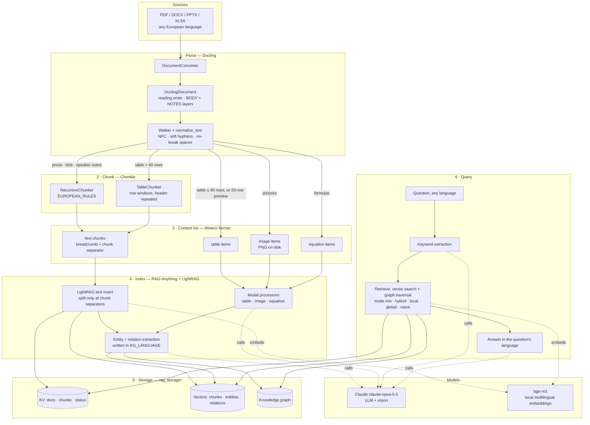

# Office-document RAG

[](https://pypi.org/project/brag-rag/)
[](https://pypi.org/project/brag-rag/)
[](https://github.com/Pakshalbhandari/brag/blob/main/LICENSE)

Retrieval-augmented Q&A over **PDF, HTML, DOCX, PPTX and XLSX** files, from local folders, SharePoint, OneDrive, Google Drive, Google Cloud Storage or Confluence, built from:

| Stage | Library | Role |
|---|---|---|
| Parse | [Docling](https://docling.ai/) | Converts PDF, HTML and Office files into a structured document: headings, paragraphs, lists, tables, images, speaker notes, sheets, pages |
| Chunk | [Chonkie](https://github.com/feyninc/chonkie) | `RecursiveChunker` for prose, `TableChunker` for large tables (header repeated in every chunk) |
| Index + query | [RAG-Anything](https://github.com/HKUDS/RAG-Anything) (on LightRAG) | Multimodal knowledge graph + vector index; tables and images are analysed by the LLM / vision model |
| Models | Claude (`claude-opus-5-5`, on the Claude API, Bedrock, Vertex AI or Foundry) + local `sentence-transformers` embeddings and optional reranker | LLM, vision, embeddings, reranking |

## Architecture

A rendered copy is at [docs/architecture.png](https://github.com/Pakshalbhandari/brag/blob/main/docs/architecture.png), for editors that don't render Mermaid.



Each Chonkie chunk ends with a `␞` separator, and LightRAG is told to split only on it, so LightRAG keeps Chonkie's chunk boundaries instead of re-chunking. Documents get IDs from a hash of their contents, so re-ingesting an unchanged file is a no-op. A manifest (`rag_storage/brag_manifest.json`) records which file holds which document, so an edited file replaces its old version instead of sitting next to it.

## Installation

```bash
pip install brag-rag        # or: uv tool install brag-rag
```

The package is published on PyPI as [`brag-rag`](https://pypi.org/project/brag-rag/). This installs the `brag` command and the `brag` Python package. Then put your API key in the environment, or in a `.env` file in the directory you run `brag` from (see [.env.example](https://github.com/Pakshalbhandari/brag/blob/main/.env.example)):

```bash
export ANTHROPIC_API_KEY=sk-ant-...
```

The embedding model (`BAAI/bge-m3` by default, about 2.3 GB) downloads on first use. Switching it later means deleting `rag_storage/` and re-ingesting, because vector dimensions change.

### From source

```bash
uv sync
cp .env.example .env   # then set ANTHROPIC_API_KEY
uv run brag --help
```

## Usage

```bash
brag parse samples/sales.xlsx          # preview chunks; no API calls
brag ontology propose samples/         # optional: entity types for this corpus
brag ingest samples/ ~/Docs/q3.pptx    # files and/or folders (recursive)
brag query "Which region grew fastest?"
brag query "Summarise the Widget Pro launch" --mode hybrid
brag chat
```

Query modes: `mix` (graph + vector, default), `hybrid`, `local`, `global`, `naive` (vector only). Answers end with a References section listing the files and the slides, sheets or pages each fact came from.

### Keeping the index in sync

```bash
brag ingest samples/            # re-run any time: new files are added, edited ones replaced
brag list                       # what is indexed, and which files no longer exist
brag remove samples/old.pptx    # drop a file, or every file under a folder
```

`brag ingest` prints one line per file (`indexed`, `updated`, `unchanged`, `empty` or `failed`), the token usage, and exits with status 1 if any file failed, so it can run in scripts and CI. Files are named in the index by their path relative to where you run `brag`, so run it from the same folder each time.

Indexes built with brag 0.1 have no manifest. Their unchanged files are picked up on the next ingest; for files edited since, start over (`rm -rf rag_storage output`, then ingest).

### Entity types (ontology)

LightRAG tags entities with generic types (person, organization, location, event, concept, …). For a specific corpus, types such as `Product`, `SalesRegion` or `FinancialMetric` give a more useful graph:

```bash
brag ontology propose samples/   # samples the files, asks Claude, writes ontology.yaml
```

Review and edit `ontology.yaml`. Only the type `name`s are used for extraction; descriptions and examples are there to help you decide. Re-running `propose` on new documents only adds types, so your edits stay. To keep a type you deleted from coming back, list it under `rejected`. When `ontology.yaml` exists, `brag ingest` uses it. Changing types after ingesting only affects documents indexed afterwards, so re-index for a consistent graph; brag warns when the types differ from the ones the index was built with.

The approach (an LLM proposes a schema from samples of the data, a person reviews it, re-runs keep edits) follows [NVIDIA auto-ontology](https://github.com/NVIDIA/auto-ontology), which does this for relational databases.

The index is stored in `./rag_storage` and parsed images in `./output`, relative to the current directory (set `WORKING_DIR` / `OUTPUT_DIR` to change this).

From Python:

```python
from dotenv import load_dotenv
from brag import RAGPipeline

load_dotenv()  # optional: the library reads settings from the environment only

pipeline = RAGPipeline()
for result in await pipeline.ingest(["docs/"]):
    print(result.source, result.status, result.error)
answer = await pipeline.query("What is the Q4 outlook?")
await pipeline.remove(["docs/old.pptx"])
await pipeline.close()
```

## Document sources

`brag sync` mirrors SharePoint document libraries, OneDrive, Google Drive folders, Google Cloud Storage buckets and Confluence spaces into an index. Each run downloads new and changed documents, re-indexes them (replacing the old version) and removes documents deleted at the source. Nothing is removed if listing a source fails.

```bash
cp sources.example.yaml sources.yaml     # one entry per source
brag sync sources.yaml                   # all sources
brag sync sources.yaml --source eng-wiki # just one
```

| Type | What | Credentials |
|---|---|---|
| `sharepoint` | A document library (`site_url`, optional `drive` and `folder`) | Entra ID app with application permissions `Sites.Read.All` and `Files.Read.All`: `MS_TENANT_ID`, `MS_CLIENT_ID`, `MS_CLIENT_SECRET` |
| `onedrive` | A user's OneDrive (`user`, optional `folder`) | as above |
| `gdrive` | A Drive folder and its subfolders (`folder_id`). Google Docs, Sheets and Slides are exported as DOCX, XLSX and PPTX (10 MB export limit) | Application Default Credentials or a service-account key; share the folder with the service account. `pip install 'brag-rag[google]'` |
| `gcs` | A bucket, optionally under a `prefix` | as above, with read access to the bucket |
| `confluence` | A Confluence Cloud space: pages (as HTML) and, unless `attachments: false`, their supported attachments | `CONFLUENCE_EMAIL` and `CONFLUENCE_API_TOKEN` |

Documents are cited as `<source>/<path>`, for example `eng-wiki/Onboarding.html`. Local copies and a per-source state file live in the index folder (`rag_storage/[workspace/]sources/<source>/`). A source with `index: finance` syncs into that index (workspace). The connectors are tested against mocked APIs that follow each provider's documentation, not against live tenants, so run a first sync on a small folder.

With the default file storage, do not run `brag sync` against an index the service is using at the same time: two processes would write the same files. Let the service sync instead (below).

## HTTP service

`brag serve` runs brag as an HTTP API for a team: people sign in with your identity provider, and each index is visible only to the groups you allow.

```bash
pip install 'brag-rag[server]'
cp access.example.yaml access.yaml        # which groups can read and write which index
export OIDC_ISSUER=https://login.microsoftonline.com/<tenant-id>/v2.0
export OIDC_AUDIENCE=api://brag
brag serve --access access.yaml --host 0.0.0.0 --port 8000
```

- **Sign-in (OIDC).** brag checks bearer tokens from any OpenID Connect provider (Entra ID, Okta, Google, Keycloak, ...): signature against the provider's published keys, issuer, audience and expiry. Clients get the token from the provider as usual; brag has no login page. Groups come from the `groups` claim, or another claim set with `OIDC_GROUPS_CLAIM` (dotted paths such as `realm_access.roles` work).
- **One index per permission group.** Each index in [access.example.yaml](https://github.com/Pakshalbhandari/brag/blob/main/access.example.yaml) is a separate LightRAG workspace with its own documents, graph and manifest. That is deliberate: a knowledge graph merges facts from all of its documents into shared entity summaries, so per-document filtering inside one graph would leak. Readers may query and list; writers may also upload and remove. An index someone cannot read answers 404, so its existence is not revealed.
- **Sources and sync.** `brag serve --sources sources.yaml` (every source needs an `index:`) lets writers start a sync with `POST /v1/indexes/{index}/sync`; `SYNC_INTERVAL_MINUTES` also syncs every index on a timer.
- **Budgets and rate limits.** Optional `limits` per index in `access.yaml`: `monthly_tokens` (Claude tokens per calendar month for that index, queries and ingestion together; uncached input, cache writes and output count, cache reads do not), `user_queries_per_minute` and `user_queries_per_day`. Over a limit, requests get `429` with `Retry-After`. Token counts are exact per index; usage is stored in `BRAG_DATA_DIR/usage.json` and survives restarts. `GET /v1/indexes/{index}/usage` shows the month's tokens and the caller's queries today.
- **Audit log.** Every query and search (who, which index, the question, and the documents the answer was built from), upload, removal, sync, finished job, denied or rate-limited request and failed sign-in is appended to `AUDIT_LOG` as JSON lines. `AUDIT_LOG_QUESTIONS=false` leaves question text out.

| Method and path | Who | What |
|---|---|---|
| `GET /healthz` | anyone | Liveness |
| `GET /v1/me` | signed in | The caller, their groups and the indexes they can use |
| `POST /v1/indexes/{index}/query` | readers | `{"question": ..., "mode": "mix"}` → answer and source documents |
| `POST /v1/indexes/{index}/retrieve` | readers | Ranked chunks without an answer |
| `GET /v1/indexes/{index}/documents` | readers | Indexed documents |
| `POST /v1/indexes/{index}/documents` | writers | Multipart upload (`files`); returns a job. A file with an existing name replaces the old version |
| `DELETE /v1/indexes/{index}/documents/{name}` | writers | Remove a document; returns a job |
| `POST /v1/indexes/{index}/sync` | writers | Pull the index's sources; returns a job |
| `GET /v1/indexes/{index}/usage` | readers | Token budget use and the caller's query count |
| `GET /v1/jobs/{job_id}` | readers of the job's index | Upload, removal or sync progress and per-file results |

Interactive API docs are at `/docs`. Uploads and removals run in the background, one at a time per index. The service runs as a single process: jobs are kept in memory (a restart forgets finished jobs, not indexed documents), and with the default file storage the indexes live in that process. Put it behind a TLS-terminating proxy; it does not serve HTTPS itself. For local development without an identity provider, `brag serve --no-auth` gives every caller full access and only binds to a loopback address.

## Evaluation

`brag eval` scores the index against a golden set of questions, so changes such as a reranker, another chunk size or a different backend can be compared with numbers instead of impressions.

```bash
brag ingest samples/
brag eval eval/samples.yaml                       # retrieval only
brag eval eval/samples.yaml --answers --output report.json
brag eval eval/samples.yaml --min-recall 0.9      # exit 1 below the threshold (for CI)
```

| Metric | What it measures | Cost |
|---|---|---|
| recall@k | Share of a question's expected sources found in the top k chunks | None in `naive` mode; one keyword call per question in graph modes |
| hit@k | Whether any expected source is in the top k | as above |
| MRR | 1 / rank of the first chunk from an expected source | as above |
| facts | Share of expected facts that appear in the answer (`--answers`) | One answer per question |
| groundedness | Share of the answer's claims the retrieved context supports, judged by Claude (`--answers`) | One judge call per question |

A golden file lists questions, the files (optionally a slide, sheet or page) each should be answered from, and facts the answer must contain; see [eval/samples.yaml](https://github.com/Pakshalbhandari/brag/blob/main/eval/samples.yaml) and the docstring of `brag.evaluation`. Write one for your own documents: a few dozen real questions tell you far more than the samples. The report records the configuration (mode, k, models, backends) next to the scores, so runs can be compared.

The [Evaluation workflow](https://github.com/Pakshalbhandari/brag/blob/main/.github/workflows/eval.yml) runs the sample set in GitHub Actions on demand; it needs an `ANTHROPIC_API_KEY` repository secret.

## Multilingual documents

Documents in any European language (Latin, Greek and Cyrillic scripts, plus Armenian and Georgian) can be mixed in one index. No language detection or per-language setup is needed.

- **Normalisation** (`multilingual.normalize_text`): applies Unicode NFC, so decomposed accents such as `u` + `¨` become `ü`. It strips soft hyphens and zero-width characters, and turns no-break spaces (including French narrow ones before `?` and `!`) into normal spaces. NFC also folds the Greek question mark into `;`.
- **Chunk boundaries** (`multilingual.EUROPEAN_RULES`): splits at paragraphs, then sentences, then clauses, then words, then characters. Sentence ends include `. ! ? … ;` and the Armenian `։`, and also count when followed by a closing quote (`" ” “ » « ’`). Unlike Chonkie's defaults, the rules never split on `'` or `-`, which would break French and Italian elisions (`l'homme`, `dell'anno`) and hyphenated compounds.
- **Embeddings**: `bge-m3` places all languages in one vector space, so an English question retrieves German, French, Greek or Polish passages.
- **Knowledge graph**: entities and descriptions are written in one canonical language (`KG_LANGUAGE`, English by default). That way "Europäische Union" and "Union européenne" merge into a single entity. Proper nouns stay in their original language.
- **Answers** come back in the language of the question.

## Configuration

All settings are environment variables; see `.env.example`. The main ones:

- `LLM_PROVIDER`: where Claude runs: `anthropic` (the Claude API, default), `bedrock`, `vertex` or `foundry`, for data-residency rules. Each uses its platform's usual credentials (`.env.example` lists them). On Vertex, install `brag-rag[vertex]`. Model IDs differ by platform: Bedrock defaults to `anthropic.claude-opus-5-5`; on Foundry set `LLM_MODEL` to your deployment name.
- `LLM_MODEL`, `LLM_EFFORT`: the Claude model and effort used for ingestion (entity extraction, table and image analysis) and for answers. Ingestion makes several LLM calls per chunk, so for large corpora a lower effort or a cheaper model is the main cost lever.
- `RERANK_MODEL`: a local cross-encoder that re-scores retrieved chunks before they reach Claude. `BAAI/bge-reranker-v2-m3` is multilingual (about 2.3 GB). Off by default; measure it with `brag eval` before keeping it.
- `KV_STORAGE`, `VECTOR_STORAGE`, `GRAPH_STORAGE`, `DOC_STATUS_STORAGE`: LightRAG storage backends, for example `PGKVStorage`, `PGVectorStorage`, `Neo4JStorage` or `QdrantVectorDBStorage`, configured with LightRAG's own variables (`POSTGRES_HOST`, `NEO4J_URI`, ...). Install the driver with an extra: `brag-rag[postgres]`, `[neo4j]`, `[qdrant]`, `[milvus]`, `[mongo]` or `[redis]`. `WORKSPACE` keeps several indexes apart in one set of backends. brag's file manifest (`rag_storage/brag_manifest.json`) and extracted images stay on local disk, so run ingestion from one machine.
- `PDF_OCR`: OCR for scanned PDFs (off by default; needs an OCR engine that Docling supports, such as `rapidocr-onnxruntime`). Text-based PDFs work without it. Borderless tables in PDFs may be read as plain text.
- `CHUNK_SIZE`: Chonkie chunk size in `o200k_base` tokens. LightRAG's limit is set 256 tokens higher to leave room for the breadcrumb.
- `TABLE_MODAL_MAX_ROWS`: the cutoff between analysing a table as one unit and row-chunking it.
- `KG_LANGUAGE`: the language the knowledge graph is written in. Changing it after ingestion mixes languages in the graph, so re-index if you change it.
- `ONTOLOGY_FILE`: where entity types are read from (default `./ontology.yaml`). Without the file, `ENTITY_TYPES` (a JSON list) or LightRAG's defaults apply.

Entity extraction sends the same long instructions with every chunk, so the system prompt is sent with prompt caching: after the first chunk it is read from cache at a fraction of the input price. `brag ingest` reports how much input was served from cache.

If a safety classifier declines a request, it is retried on a fallback model: on the Claude API through the server-side `fallbacks` parameter (the server picks the model unless `LLM_FALLBACK_MODEL` is set), on Bedrock, Vertex and Foundry through the SDK's client-side fallback middleware (default fallback `claude-opus-4-8`).

## Layout

```
src/brag/cli.py           `brag` command
src/brag/config.py        settings
src/brag/parsing.py       Docling → Chonkie → RAG-Anything content list
src/brag/multilingual.py  Unicode normalisation + European chunking rules
src/brag/models.py        Claude LLM/vision (prompt caching, token usage) + local embeddings
src/brag/pipeline.py      LightRAG + RAG-Anything wiring: ingest, update, remove, query
src/brag/manifest.py      which file is indexed under which document ID
src/brag/ontology.py      entity-type proposal and ontology.yaml
src/brag/evaluation.py    golden-set evaluation (recall@k, MRR, facts, groundedness)
src/brag/service/         HTTP API: OIDC auth, per-index access, limits, audit log, jobs
src/brag/connectors/      SharePoint/OneDrive, Google Drive, GCS and Confluence sources, and sync
eval/samples.yaml         golden questions for samples/
tests/                    pytest suite; no API key needed (the PDF test downloads Docling's layout model once)
samples/                  example files in English, German, French, Greek and Polish
```

## Development

```bash
uv sync
uv run pytest
```

## Releasing

1. Bump `__version__` in `src/brag/__init__.py`.
2. Optional dry run: run the Publish workflow by hand from the Actions tab; it uploads to [TestPyPI](https://test.pypi.org/project/brag-rag/). TestPyPI rejects re-uploads of the same version, so bump the version before each dry run.
3. Create a GitHub release tagged `v<version>` (e.g. `v0.2.0`).
4. The [publish workflow](https://github.com/Pakshalbhandari/brag/blob/main/.github/workflows/publish.yml) builds the sdist and wheel and uploads them to PyPI with trusted publishing.

To publish by hand instead: `uv build && uv publish` (needs a PyPI API token).

## License

[MIT](https://github.com/Pakshalbhandari/brag/blob/main/LICENSE)
