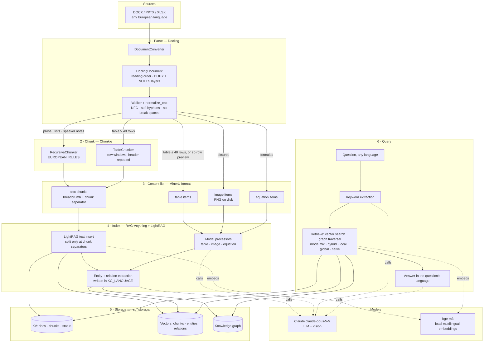

# Office-document RAG

Retrieval-augmented Q&A over **DOCX, PPTX and XLSX** files, built from:

| Stage | Library | Role |
|---|---|---|
| Parse | [Docling](https://docling.ai/) | Converts Office files into a structured document: headings, paragraphs, lists, tables, images, speaker notes, sheets |
| Chunk | [Chonkie](https://github.com/feyninc/chonkie) | `RecursiveChunker` for prose, `TableChunker` for large tables (header repeated in every chunk) |
| Index + query | [RAG-Anything](https://github.com/HKUDS/RAG-Anything) (on LightRAG) | Multimodal knowledge graph + vector index; tables and images are analysed by the LLM / vision model |
| Models | Claude (`claude-opus-5-5`) + local `sentence-transformers` embeddings | LLM, vision and embeddings |

## Architecture

A rendered copy is at [docs/architecture.png](docs/architecture.png), for editors that don't render Mermaid.



Each Chonkie chunk ends with a `␞` separator, and LightRAG is told to split only on it, so LightRAG keeps Chonkie's chunk boundaries instead of re-chunking. Documents get IDs from a hash of their contents, so re-ingesting an unchanged file is a no-op.

## Setup

```bash
uv sync
cp .env.example .env   # then set ANTHROPIC_API_KEY
```

The embedding model (`BAAI/bge-m3` by default, about 2.3 GB) downloads on first use. Switching it later means deleting `rag_storage/` and re-ingesting, because vector dimensions change.

## Usage

```bash
uv run rag.py parse samples/sales.xlsx        # preview chunks; no API calls
uv run rag.py ingest samples/ ~/Docs/q3.pptx   # files and/or folders (recursive)
uv run rag.py query "Which region grew fastest?"
uv run rag.py query "Summarise the Widget Pro launch" --mode hybrid
uv run rag.py chat
```

Query modes: `mix` (graph + vector, default), `hybrid`, `local`, `global`, `naive` (vector only).

From Python:

```python
from rag_pipeline.pipeline import RAGPipeline

pipeline = RAGPipeline()
await pipeline.ingest(["docs/"])
answer = await pipeline.query("What is the Q4 outlook?")
await pipeline.close()
```

## Multilingual documents

Documents in any European language (Latin, Greek and Cyrillic scripts, plus Armenian and Georgian) can be mixed in one index. No language detection or per-language setup is needed.

- **Normalisation** (`multilingual.normalize_text`): applies Unicode NFC, so decomposed accents such as `u` + `¨` become `ü`. It strips soft hyphens and zero-width characters, and turns no-break spaces (including French narrow ones before `?` and `!`) into normal spaces. NFC also folds the Greek question mark into `;`.
- **Chunk boundaries** (`multilingual.EUROPEAN_RULES`): splits at paragraphs, then sentences, then clauses, then words, then characters. Sentence ends include `. ! ? … ;` and the Armenian `։`, and also count when followed by a closing quote (`" ” “ » « ’`). Unlike Chonkie's defaults, the rules never split on `'` or `-`, which would break French and Italian elisions (`l'homme`, `dell'anno`) and hyphenated compounds.
- **Embeddings**: `bge-m3` places all languages in one vector space, so an English question retrieves German, French, Greek or Polish passages.
- **Knowledge graph**: entities and descriptions are written in one canonical language (`KG_LANGUAGE`, English by default). That way "Europäische Union" and "Union européenne" merge into a single entity. Proper nouns stay in their original language.
- **Answers** come back in the language of the question.

## Configuration

All settings are environment variables; see `.env.example`. The main ones:

- `LLM_MODEL`, `LLM_EFFORT`: the Claude model and effort used for ingestion (entity extraction, table and image analysis) and for answers. Ingestion makes several LLM calls per chunk, so for large corpora a lower effort or a cheaper model is the main cost lever.
- `CHUNK_SIZE`: Chonkie chunk size in `o200k_base` tokens. LightRAG's limit is set 256 tokens higher to leave room for the breadcrumb.
- `TABLE_MODAL_MAX_ROWS`: the cutoff between analysing a table as one unit and row-chunking it.
- `KG_LANGUAGE`: the language the knowledge graph is written in. Changing it after ingestion mixes languages in the graph, so re-index if you change it.

Requests use Claude's server-side refusal fallback (`fallbacks="default"`). If a safety classifier declines a request, it is retried on a fallback model.

## Layout

```
rag.py                    CLI
rag_pipeline/config.py    settings
rag_pipeline/parsing.py   Docling → Chonkie → RAG-Anything content list
rag_pipeline/multilingual.py  Unicode normalisation + European chunking rules
rag_pipeline/models.py    Claude LLM/vision + local embedding functions
rag_pipeline/pipeline.py  RAGAnything wiring, ingest, query
samples/                  example files in English, German, French, Greek and Polish
```
